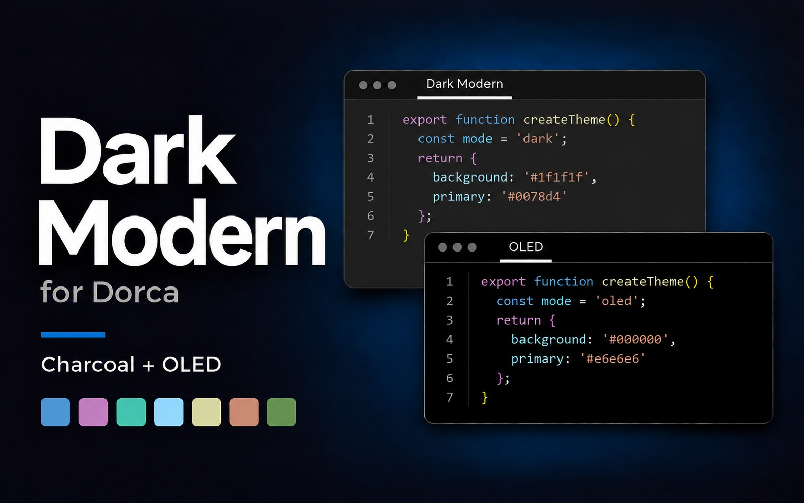
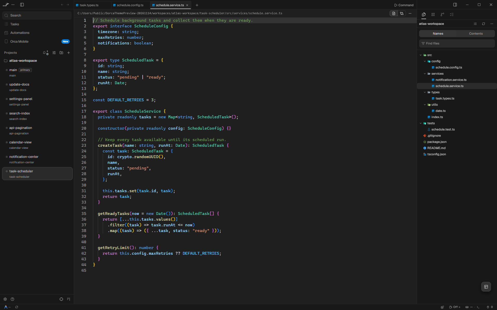
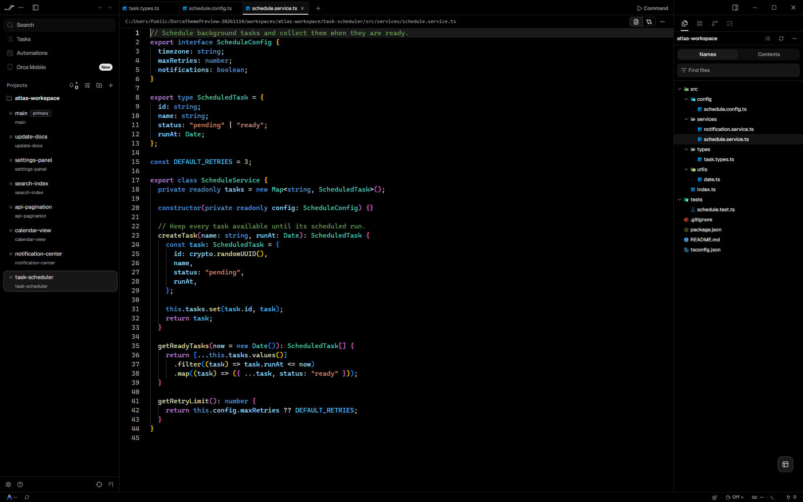

# Dark Modern for Dorca

**Dark Modern** brings charcoal surfaces and VS Code Dark Modern syntax colors to Dorca. **Dark Modern OLED** pairs the same syntax palette with true-black surfaces and adds a matching terminal palette.



## Install

Requires **Dorca 2.0.10 or later** with plugins enabled. Run these commands with the `orca` CLI bundled with Dorca.

```sh
orca plugin install danpaker4/dark-modern-for-dorca
```

You can also download the plugin ZIP from [Releases](https://github.com/danpaker4/dark-modern-for-dorca/releases), extract it, and install the extracted folder.

```sh
orca plugin install ./dark-modern-for-dorca-v1.0.0
```

## Choose a theme

In **Settings → Appearance**, set **Dark theme** to **Dark Modern** or **Dark Modern OLED**. Set **Dark editor theme** to **Same as app theme** to match the app, or select either editor theme independently. You can also choose either theme under **Light editor theme** if you prefer a dark editor while the app is in light mode.

For the OLED terminal palette, select **Dark Modern OLED** under **Appearance → Terminal → Dark theme**.

## Previews





## Credits

The syntax and Dark Modern palette come from [VS Code Default Themes for Orca](https://github.com/stablyai/orca-plugins/blob/2c75903f33203dede2d40db5fcc314aed19d3934/plugins/vscode-default-themes/themes/vs-code-dark-modern.json). The OLED app and terminal palettes come from [Orca OLED](https://github.com/stablyai/orca-plugins/tree/b411f469fb8e24d2520553aa82d14cde9f26de4f/plugins/oled-theme).

## License

Dark Modern for Dorca is licensed under the [MIT License](LICENSE).

Upstream MIT notices are included for [Microsoft’s Dark Modern theme](LICENSE-DARK-MODERN) and [Lovecast’s Orca OLED theme](LICENSE-OLED).
